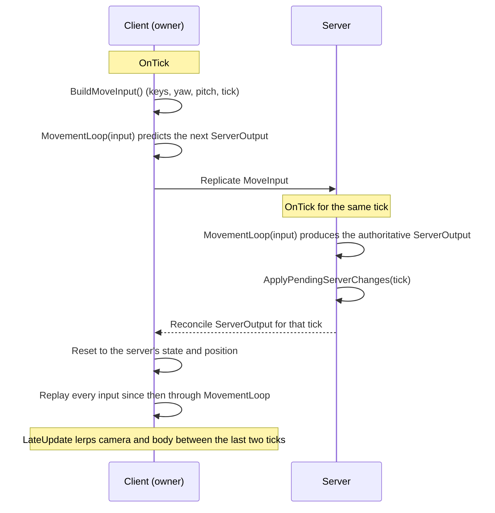

# Capsule Clash

3D multiplayer FPS built in Unity 6 about data and AI. Fight other players, build cover mid-fight, and travel between dimensions.

Everything is C# and hand-written HLSL, networking is on top of [Fish-Net](https://fish-networking.gitbook.io/docs).

> **Status:** in active development

## Gameplay

- Place floors, walls, and ramps on a grid mid-fight. Anything that loses its connection to the ground collapses.
- Quake-style acceleration and friction, sprinting, dashing, and ground detection that sticks to slopes.
- Kills give capsule essence, which can be delivered to agents for keys, which can be delivered to the main server for upgrade tokens. Tokens can be spent on nine upgrades (speed, jump, dash force, dash regen, health regen, stamina regen, fire rate, damage, reload speed) with four levels each.
- Portals lead to areas with their own rules:
  - **Desert:** starting area
  - **Maze:** building, dashing, and jump upgrades disabled
  - **Space:** lower gravity, higher jumps, faster dash cooldowns
  - **Tundra:** ice is slippery, and shooting pushes you forward

### Controls

| Action | Default key |
| --- | --- |
| Move | `W` `A` `S` `D` |
| Jump / dash | `Space` |
| Sprint | `Shift` |
| Shoot | Left mouse |
| Aim | Right mouse or `Ctrl` |
| Reload | `R` |
| Switch to AR / Shotgun / Sniper | `1` / `2` / `3` |
| Build floor / wall / ramp | `X` / `Z` / `C` |
| Break build | `V` |
| Inventory | `I` |
| Heal | `Q` |
| Upgrade Menu | `T` |
| Buy upgrade | `1`–`9` while in upgrade menu |
| Respawn (when dead) | `R` |

Build keys can be rebound in the settings menu.

## Technical highlights

### Client-side prediction

Movement runs on Fish-Net ticks (30/s)



- `MoveInput` struct with replicate data tracks user inputs, trusting no values the client might tamper with to gain an unfair advantage
- The movement loop is run on both the client and the server, and the results are immediately applied on the client to prevent input delay
- The server rebuilds the client ticks from its own simState to ensure the server and client match
- Camera and player/rendered body lerped between ticks to prevent jitter
- Stamina moved to server authoritative model

### Server authority

Clients send inputs and requests, the server simulates or validates them, and results go back out through reconciles, `SyncVar`s, and `ObserversRpc`s.

- **Movement:** the server runs `MovementLoop` on the client's inputs and its result always wins. Clients send inputs, never positions.
- **Stamina:** part of the simulated state now, so the server decides when you're out and can't sprint, not the client's HUD.
- **Event changes:** things that start outside the loop (landing, dash vectors, shot boost, launches, position fixes) are sent as `ServerRpc`s with the tick they happened on. The server queues them (`QueueServerChange`) and applies them on that exact tick (`ApplyPendingServerChanges`) so they line up with the inputs.
- **Bullets** are spawned by the server. Each tick `BulletManager` raycasts from a bullet's last position to its current one
- Fire rate is enforced server side with a token bucket per gun (`TryConsumeServerShot`)
- **Health, spawn protection, and damage multipliers** are server-owned `SyncVar`s in `DamageControl`, clients can't edit them.
- **Build pieces** are spawned and despawned only by the server (`ObjectSpawner`).

### Building and structural collapse

`ObjectSpawner` snaps pieces to a grid. It checks for valid placement using overlap when placing builds. After any broken builds, a support pass runs a breadth-first search

BFS Build Destruction Logic:
1. Seeds every piece resting on solid ground.
2. Walk outward through touching neighbors, marking each one supported.
3. Collapse everything the search never reached.

### Movement

`PlayerMovement` is a custom character controller

- Movement moves toward a target velocity based on current max speed, with separate ground and air acceleration
- Friction, plus per-dimension acceleration/friction picked inside the tick loop
- Sprinting, dashing, and jump buffering
- Sphere-cast ground detection with ledge probing with gizmo for debugging
- Input projected onto the floor normal for slope handling, and sliding on slopes that are too steep

### Rendering

All custom shaders are in `Assets/Custom Shaders`

| Shader | Purpose |
| --- | --- |
| `CustomCel-Outline` | Comic-book cel shading with an inverted-hull outline pass |
| `CustomCel-Terrain` | Cel shading and outlines for terrain |
| `ComicBookPostProcess` | Full-screen comic-book post-processing |
| `RetroDither` | Four-pass retro dithering post-process |
| `CameraMotionBlur`, `FogShader` | Motion blur and fog post-processing (not used in game) |
| `UI_ComicBook`, `UI_RetroDither` | Matching effects for UI |

Runtime controllers for them are in `Assets/Scripts/PPE_Shader_Controllers`. Early shader experiments are kept in `Unused-EarlyIterations`.

## Unity Editor Setup
Please feel free to clone this repo and modify the game. I please ask that you do not use this repo for commercial benifit or copy the game

### Requirements

- **Unity 6000.3.17f1** (Unity 6)
- **[Git LFS](https://git-lfs.com/)**, large assets are stored with LFS

### Setup

```bash
git lfs install
git clone https://github.com/brody-b9801/Capsule-Clash.git
```

1. Open the folder in Unity Hub with the version above.
2. Open `Assets/Scenes/CombatScene.unity`.

### Playing locally

The client connects to the address and port set on the `RoomMenu` component (default `localhost:7770`).

- **Testing in the Editor:** turn on **Host Locally** on `RoomMenu`, pressing Start then launches a server alongside the client.
- **Playing against a dedicated server:** point `serverAddress` at the machine running a server build.

### CI

`.github/workflows/gameci.yml` builds the Windows client with [GameCI](https://game.ci/) on a self-hosted Windows runner (label `unity_windows`), checks out LFS assets, and uploads the build to Steam. Runs manually from the Actions tab.

Needs Repository secrets:

- `RUNNER_LICENSE`
- `UNITY_EMAIL`
- `UNITY_PASSWORD`

## Project structure

| Folder | Contents |
| --- | --- |
| `Assets/Scripts/Movement and Player` | Character controller and CSP loop, stamina, upgrades, and the Server NPC |
| `Assets/Scripts/Bullets and Guns` | Shooting, the bullet simulation, and damage |
| `Assets/Scripts/Building Mechanic` | Placement, build health, and structural support |
| `Assets/Scripts/Menu and UI` | Menus, settings, HUD, and leaderboard |
| `Assets/Scripts/PPE_Shader_Controllers` | Post-processing effect controllers |
| `Assets/Scripts/Procedural Effects and Animations` | Camera shake, particles, and procedural animation |
| `Assets/Scripts/Helpers` | Editor and level-building utilities, including a maze generator |
| `Assets/Custom Shaders` | Hand-written HLSL shaders |
| `Assets/Editor` | Build script and custom inspectors |
| `Assets/FishNet` | Fish-Net networking library (third party), unmodified except for the files below and a Steamworks reference added to `FishNet.Demos.asmdef` |
| `Assets/Scripts/fishnet-modified` | Fish-Net scripts I've modified, pulled out so they're easy to find and don't get overwritten on a Fish-Net update. Stuff in `Runtime/` has a `FishNet.Runtime.Modified.asmref` that keeps it compiling inside the `FishNet.Runtime` assembly |

Modified Fish-Net scripts:

- `NetworkHudCanvases.cs`: started as the Fish-Net demo HUD, now basically the whole connection flow (Steam lobbies, room browser and lobby codes, room creation, error screen, clean leave on quit, disconnect telemetry)
- `Runtime/TransportManager.cs`: added `localTesting`, `TugboatRef`, and `FishySteamRef`, the transport gets picked on init, Tugboat for local testing and FishySteamworks for prod
- `Runtime/NetworkObject.cs`: commented out the `gameObject.SetActive(false)` on scene objects during edit so they don't get disabled
